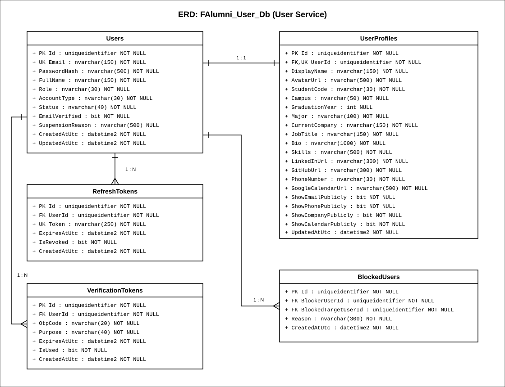

# FPT Alumni Connect — User Service (`f-alumni-user-service`)

Dịch vụ Quản lý Định danh, Xác thực JWT, Danh bạ Cựu sinh viên, Quyền riêng tư và gRPC Profile Server thuộc hệ thống **FPT Alumni Connect** (PRN232 Final Assignment). Được xây dựng theo chuẩn kiến trúc 3 tầng `.NET 10` (`Api -> Services -> Repositories`), gRPC Server (`UserProfileService`), và Kafka Producer (`user.registered.v1`).

- **Owner**: Trương Chí Trung (`chstrg2208` — Backend 1)
- **Database**: `FAlumni_User_Db` (Độc lập 100% — Zero Cross-Database Foreign Keys)
- **Tài liệu ERD Database**: [`docs/ERD.md`](docs/ERD.md) | [`docs/architecture/f-alumni-user-db-erd.svg`](docs/architecture/f-alumni-user-db-erd.svg) | [`docs/architecture/f-alumni-user-db-erd.drawio`](docs/architecture/f-alumni-user-db-erd.drawio)
- **Tài liệu Kiến trúc Hệ thống**: [`docs/ARCHITECTURE.md`](docs/ARCHITECTURE.md)

---

## 🗄️ Sơ Đồ ERD Cơ Sở Dữ Liệu (`FAlumni_User_Db`)



> Xem đặc tả chi tiết từng bảng, kiểu dữ liệu, khóa ngoại và chỉ mục tại [`docs/ERD.md`](docs/ERD.md).

---

## 🚀 Các User Stories Đã Hoàn Thành (Guideline & Google Sheet)

| Mã US | Tính năng | Endpoint / Giao thức |
| :--- | :--- | :--- |
| **US-01** | Đăng ký tài khoản & Đăng nhập bằng Email / Mật khẩu | `POST /api/v1/auth/register`, `POST /api/v1/auth/login` |
| **US-02** | Đăng nhập nhanh bằng Google OAuth / ID Token | `POST /api/v1/auth/google` |
| **US-03** | Xác thực địa chỉ Email bằng mã OTP 6 chữ số + Phát sự kiện Kafka `user.registered.v1` | `POST /api/v1/auth/verify-email` |
| **US-04** | Xem & Cập nhật hồ sơ cá nhân (`Campus`, `Major`, `GraduationYear`, `Bio`, `AvatarUrl`, `Skills`) | `GET /api/v1/users/me`, `PUT /api/v1/users/me` |
| **US-05 / US-06** | Danh bạ Cựu sinh viên có phân trang & Lọc đa tiêu chí (`search`, `campus`, `major`, `graduationYear`) | `GET /api/v1/users`, `GET /api/v1/users/{id}` |
| **US-07** | Đổi mật khẩu & Quên mật khẩu qua OTP | `POST /api/v1/auth/change-password`, `POST /api/v1/auth/forgot-password`, `POST /api/v1/auth/reset-password` |
| **US-08** | Làm mới JWT Token & Đăng xuất (Thu hồi Refresh Token) | `POST /api/v1/auth/refresh-token`, `POST /api/v1/auth/logout` |
| **US-09** | Cài đặt quyền riêng tư hiển thị hồ sơ công khai (`ShowEmail`, `ShowPhone`, `ShowCompany`, `ShowCalendar`) | `PUT /api/v1/users/me/privacy` |
| **US-10** | Chặn & Bỏ chặn người dùng (`BlockedUsers`) | `GET /api/v1/users/me/blocks`, `POST /api/v1/users/{id}/block`, `DELETE /api/v1/users/{id}/block` |
| **US-11** | Liên kết đặt lịch hẹn Google Calendar trên hồ sơ | Trường `GoogleCalendarUrl` trên `UserProfiles` |
| **gRPC Server** | Cung cấp thông tin tóm tắt người dùng nội bộ cho `Chat Service` | `UserProfileGrpcService` (`contracts/grpc/user-profile/v1/user_profile.proto`) |
| **AD-03 / AD-04** | Khóa / Mở khóa tài khoản & Phân quyền dành cho Admin Service | `POST /api/v1/users/{id}/suspend`, `POST /api/v1/users/{id}/unsuspend`, `PUT /api/v1/users/{id}/role` |

---

## 🛠️ Chạy Kiểm Thử & Xác Minh Hợp Đồng

```powershell
# 1. Xác minh tính toàn vẹn hợp đồng SHA-256
.\scripts\verify-contracts.ps1

# 2. Chạy toàn bộ Unit Test & Integration Test
dotnet test UserService.sln --configuration Release
```
