# Class Diagram — User Service (`f-alumni-user-service`)

> **Thành viên thực hiện**: Trương Chí Trung (`chstrg2208` — Backend 1)  
> **Service**: `f-alumni-user-service` (.NET 10 — 3-Layer Architecture)  
> **File Draw.io (Trắng Đen Chuẩn UML)**: [`docs/architecture/f-alumni-user-class-diagram.drawio`](architecture/f-alumni-user-class-diagram.drawio)

---

## 1. Cấu Trúc 4 Tầng Trong Class Diagram (`User Service`)

1. **Tầng 1 — Presentation / API & gRPC Layer (`UserService.Api`)**:
   - `AuthController`: Xử lý đăng ký (`register`), xác thực OTP (`verify-email`), đăng nhập Email (`login`), đăng nhập Google OAuth (`google`), làm mới phiên (`refresh-token`), đăng xuất (`logout`), đổi/quên mật khẩu (`change-password`, `forgot-password`, `reset-password`).
   - `UsersController`: Tra cứu danh bạ cựu sinh viên (`GetDirectory`), xem/cập nhật hồ sơ cá nhân (`GetMyProfile`, `UpdateMyProfile`, `UpdateMyAvatar`, `UpdateMyCalendarLink`, `UpdateMyPrivacy`) và chặn/bỏ chặn người dùng (`BlockUser`, `UnblockUser`, `GetMyBlockedUsers`).
   - `InternalUsersController`: Endpoint nội bộ cho `Admin Service` gọi khóa/mở khóa tài khoản (`SuspendUser`, `UnsuspendUser`).
   - `UserProfileGrpcService`: gRPC Server (`user_profile.proto`) cung cấp RPC `GetUserSummary` qua HTTP/2 Protobuf cho `Chat Service`.
2. **Tầng 2 — Business Logic / Application Services Layer (`UserService.Services`)**:
   - `IAuthService` / `AuthService`: Nghiệp vụ xác thực, tạo mã OTP 6 số, phát hành JWT + RefreshToken, bắn sự kiện Kafka `user.registered.v1`.
   - `IUserProfileAppService` / `UserProfileAppService`: Nghiệp vụ hồ sơ, lọc quyền riêng tư (`ShowEmailPublicly`, `ShowPhonePublicly`, `ShowCompanyPublicly`, `ShowCalendarPublicly`), khóa tài khoản và bắn sự kiện Kafka `user.suspended.v1`.
   - `IKafkaEventPublisher` / `KafkaEventPublisher`: Đóng gói `EventEnvelope` và publish bất đồng bộ lên Apache Kafka.
   - `PasswordHasher`: Băm và kiểm tra mật khẩu chuẩn `PBKDF2-SHA256`.
3. **Tầng 3 — Data Access / Repositories Layer (`UserService.Repositories`)**:
   - `IUserRepository` / `UserRepository`: Truy vấn EF Core bất đồng bộ trên `UserServiceDbContext`.
   - `UserServiceDbContext`: Quản lý 5 `DbSet` ánh xạ xuống `FAlumni_User_Db`.
4. **Tầng 4 — Domain Entities (`UserService.Repositories.Entities`)**:
   - `User`, `UserProfile`, `RefreshToken`, `VerificationToken`, `BlockedUser`.

---

## 2. Sơ Đồ Class Diagram (Mermaid)

```mermaid
classDiagram
    direction TB

    class AuthController {
        -IAuthService _authService
        +Register(RegisterRequest) Task~ActionResult~RegisterResponse~~
        +VerifyEmail(VerifyEmailRequest) Task~ActionResult~AuthTokenResponse~~
        +Login(LoginRequest) Task~ActionResult~AuthTokenResponse~~
        +GoogleLogin(GoogleLoginRequest) Task~ActionResult~AuthTokenResponse~~
        +RefreshToken(RefreshTokenRequest) Task~ActionResult~AuthTokenResponse~~
        +Logout(LogoutRequest) Task~IActionResult~
        +ChangePassword(ChangePasswordRequest) Task~IActionResult~
        +ForgotPassword(ForgotPasswordRequest) Task~ActionResult~RegisterResponse~~
        +ResetPassword(ResetPasswordRequest) Task~IActionResult~
    }

    class UsersController {
        -IUserProfileAppService _userProfileService
        +GetDirectory(search, campus, gradYear, major, company, pageNumber, pageSize) Task~ActionResult~PagedResponse~~
        +GetMyProfile() Task~ActionResult~UserProfileResponse~~
        +UpdateMyProfile(UpdateUserProfileRequest) Task~ActionResult~UserProfileResponse~~
        +UpdateMyAvatar(UpdateAvatarRequest) Task~ActionResult~UserProfileResponse~~
        +UpdateMyCalendarLink(UpdateCalendarLinkRequest) Task~ActionResult~UserProfileResponse~~
        +UpdateMyPrivacy(UpdatePrivacySettingsRequest) Task~ActionResult~UserProfileResponse~~
        +GetMyBlockedUsers() Task~ActionResult~IReadOnlyList~BlockedUserResponse~~~
        +BlockUser(Guid id, BlockUserRequest) Task~ActionResult~BlockedUserResponse~~
        +UnblockUser(Guid id) Task~IActionResult~
        +GetUserById(Guid id) Task~ActionResult~UserProfileResponse~~
    }

    class InternalUsersController {
        -IUserProfileAppService _userProfileService
        +SuspendUser(Guid id, SuspendUserRequest) Task~ActionResult~UserProfileResponse~~
        +UnsuspendUser(Guid id) Task~ActionResult~UserProfileResponse~~
    }

    class UserProfileGrpcService {
        -IUserProfileAppService _userProfileService
        -ILogger~UserProfileGrpcService~ _logger
        +GetUserSummary(GetUserSummaryRequest, ServerCallContext) Task~GetUserSummaryResponse~
    }

    class IAuthService {
        <<interface>>
        +RegisterAsync(RegisterRequest) Task~RegisterResponse~
        +VerifyEmailAsync(VerifyEmailRequest) Task~AuthTokenResponse~
        +LoginAsync(LoginRequest) Task~AuthTokenResponse~
        +GoogleLoginAsync(GoogleLoginRequest) Task~AuthTokenResponse~
        +RefreshTokenAsync(RefreshTokenRequest) Task~AuthTokenResponse~
        +LogoutAsync(Guid userId, LogoutRequest) Task
        +ChangePasswordAsync(Guid userId, ChangePasswordRequest) Task
        +ForgotPasswordAsync(ForgotPasswordRequest) Task~RegisterResponse~
        +ResetPasswordAsync(ResetPasswordRequest) Task
    }

    class AuthService {
        -IUserRepository _userRepository
        -IKafkaEventPublisher _kafkaPublisher
        -IConfiguration _configuration
    }

    class IUserProfileAppService {
        <<interface>>
        +GetByIdAsync(Guid userId, bool isOwnerOrAdmin) Task~UserProfileResponse~
        +UpdateProfileAsync(Guid userId, UpdateUserProfileRequest) Task~UserProfileResponse~
        +UpdateAvatarAsync(Guid userId, UpdateAvatarRequest) Task~UserProfileResponse~
        +UpdateCalendarLinkAsync(Guid userId, UpdateCalendarLinkRequest) Task~UserProfileResponse~
        +UpdatePrivacySettingsAsync(Guid userId, UpdatePrivacySettingsRequest) Task~UserProfileResponse~
        +BlockUserAsync(Guid blockerId, Guid targetId, BlockUserRequest) Task~BlockedUserResponse~
        +UnblockUserAsync(Guid blockerId, Guid targetId) Task
        +GetDirectoryPagedAsync(...) Task~PagedResponse~UserProfileResponse~~
        +SuspendUserAsync(Guid userId, SuspendUserRequest) Task~UserProfileResponse~
        +UnsuspendUserAsync(Guid userId) Task~UserProfileResponse~
    }

    class UserProfileAppService {
        -IUserRepository _userRepository
        -IKafkaEventPublisher _kafkaPublisher
    }

    class IKafkaEventPublisher {
        <<interface>>
        +PublishAsync~TPayload~(string topic, string eventType, TPayload payload) Task
    }

    class KafkaEventPublisher {
        -IConfiguration _configuration
        -ILogger~KafkaEventPublisher~ _logger
    }

    class PasswordHasher {
        <<static>>
        +HashPassword(string password) string
        +VerifyPassword(string password, string storedHash) bool
    }

    class IUserRepository {
        <<interface>>
        +GetByIdAsync(Guid id) Task~User~
        +GetByEmailAsync(string email) Task~User~
        +CreateAsync(User user) Task~User~
        +UpdateAsync(User user) Task~User~
        +GetDirectoryPagedAsync(...) Task~Tuple~
        +CreateVerificationTokenAsync(VerificationToken) Task~VerificationToken~
        +CreateRefreshTokenAsync(RefreshToken) Task~RefreshToken~
        +RevokeAllUserRefreshTokensAsync(Guid userId) Task
        +BlockUserAsync(Guid blockerId, Guid targetId, string reason) Task~BlockedUser~
    }

    class UserRepository {
        -UserServiceDbContext _dbContext
    }

    class UserServiceDbContext {
        +DbSet~User~ Users
        +DbSet~UserProfile~ UserProfiles
        +DbSet~RefreshToken~ RefreshTokens
        +DbSet~VerificationToken~ VerificationTokens
        +DbSet~BlockedUser~ BlockedUsers
    }

    class User {
        +Guid Id
        +string Email
        +string PasswordHash
        +string FullName
        +string Role
        +string AccountType
        +string Status
        +bool EmailVerified
        +string SuspensionReason
        +DateTime CreatedAtUtc
        +DateTime UpdatedAtUtc
    }

    class UserProfile {
        +Guid Id
        +Guid UserId
        +string DisplayName
        +string AvatarUrl
        +string StudentCode
        +string Campus
        +int GraduationYear
        +string Major
        +string CurrentCompany
        +string JobTitle
        +string GoogleCalendarUrl
        +bool ShowEmailPublicly
        +bool ShowPhonePublicly
        +bool ShowCompanyPublicly
        +bool ShowCalendarPublicly
    }

    class RefreshToken {
        +Guid Id
        +Guid UserId
        +string Token
        +DateTime ExpiresAtUtc
        +bool IsRevoked
    }

    class VerificationToken {
        +Guid Id
        +Guid UserId
        +string OtpCode
        +string Purpose
        +DateTime ExpiresAtUtc
        +bool IsUsed
    }

    class BlockedUser {
        +Guid Id
        +Guid BlockerUserId
        +Guid BlockedTargetUserId
        +string Reason
    }

    AuthController --> IAuthService
    UsersController --> IUserProfileAppService
    InternalUsersController --> IUserProfileAppService
    UserProfileGrpcService --> IUserProfileAppService

    AuthService ..|> IAuthService
    UserProfileAppService ..|> IUserProfileAppService
    KafkaEventPublisher ..|> IKafkaEventPublisher
    UserRepository ..|> IUserRepository

    AuthService --> IUserRepository
    AuthService --> IKafkaEventPublisher
    AuthService --> PasswordHasher
    UserProfileAppService --> IUserRepository
    UserProfileAppService --> IKafkaEventPublisher

    UserRepository --> UserServiceDbContext
    UserServiceDbContext --> User
    UserServiceDbContext --> UserProfile
    UserServiceDbContext --> RefreshToken
    UserServiceDbContext --> VerificationToken
    UserServiceDbContext --> BlockedUser
    User "1" --> "1" UserProfile
    User "1" --> "*" RefreshToken
    User "1" --> "*" VerificationToken
```

