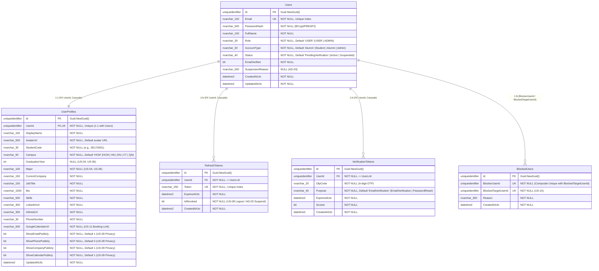

# 🗄️ Sơ Đồ ERD Cơ Sở Dữ Liệu — User Service (`FAlumni_User_Db`)

> **Service**: `f-alumni-user-service`  
> **Người phụ trách**: Trương Chí Trung (`chstrg2208` — Backend 1)  
> **Cơ sở dữ liệu**: `FAlumni_User_Db` (SQL Server + EF Core 10)  
> **Nguyên tắc kiến trúc**: Database-per-Service — Độc lập 100%, không chia sẻ bảng hay khóa ngoại (Zero Cross-Database Foreign Keys) với các Microservices khác.

---

## 1. Hình Ảnh Sơ Đồ ERD Trực Quan (SVG & Draw.io)

- **File Vector SVG**: [`docs/architecture/f-alumni-user-db-erd.svg`](architecture/f-alumni-user-db-erd.svg)
- **File Draw.io (Mở trên diagrams.net)**: [`docs/architecture/f-alumni-user-db-erd.drawio`](architecture/f-alumni-user-db-erd.drawio)

---

## 2. Sơ Đồ ERD Chuẩn Mermaid (`FAlumni_User_Db`)

---

## 3. Đặc Tả Chi Tiết Các Bảng & Ràng Buộc (Data Dictionary)

### 3.1. Bảng `Users` (Định danh & Bảo mật cốt lõi)
- **Mục đích**: Lưu thông tin tài khoản, phân quyền (`USER`, `ADMIN`), loại tài khoản (`Student`, `Alumni`, `Admin`) và trạng thái kích hoạt/khóa (`PendingVerification`, `Active`, `Suspended`).
- **Khóa & Chỉ mục**:
  - `PK_Users`: `Id` (`uniqueidentifier`).
  - `IX_Users_Email` (**Unique Index**): Đảm bảo mỗi email FPT/cá nhân chỉ đăng ký 1 tài khoản duy nhất.

### 3.2. Bảng `UserProfiles` (Hồ sơ Cựu sinh viên & Quyền riêng tư)
- **Mục đích**: Phục vụ các User Stories từ **US-04 đến US-11** (Danh bạ cựu sinh viên, lọc theo `Campus`, `Major`, `GraduationYear`, cài đặt quyền riêng tư **US-09**, và đặt lịch hẹn Google Calendar **US-11**) cũng như trả dữ liệu cho **gRPC Server** (`UserProfileGrpcService`).
- **Khóa & Quan hệ**:
  - `PK_UserProfiles`: `Id` (`uniqueidentifier`).
  - `IX_UserProfiles_UserId` (**Unique Index** + **Foreign Key**): Quan hệ `1 : 1` chặt chẽ với bảng `Users` (`OnDelete: Cascade`).

### 3.3. Bảng `RefreshTokens` (Quản lý phiên đăng nhập JWT)
- **Mục đích**: Cấp mới Access Token và hỗ trợ thu hồi phiên tức thì khi người dùng đăng xuất (**US-08**) hoặc khi Admin khóa tài khoản (**AD-03**).
- **Khóa & Quan hệ**:
  - `PK_RefreshTokens`: `Id` (`uniqueidentifier`).
  - `IX_RefreshTokens_Token` (**Unique Index**): Tra cứu token nhanh với độ phức tạp $O(1)$.
  - `FK_RefreshTokens_Users_UserId`: Quan hệ `N : 1` với `Users` (`OnDelete: Cascade`).

### 3.4. Bảng `VerificationTokens` (Xác thực OTP Email & Quên mật khẩu)
- **Mục đích**: Lưu mã OTP 6 chữ số để kích hoạt tài khoản (**US-03**) và đặt lại mật khẩu.
- **Khóa & Quan hệ**:
  - `PK_VerificationTokens`: `Id` (`uniqueidentifier`).
  - `FK_VerificationTokens_Users_UserId`: Quan hệ `N : 1` với `Users` (`OnDelete: Cascade`).

### 3.5. Bảng `BlockedUsers` (Danh sách chặn tương tác — US-10)
- **Mục đích**: Cho phép người dùng chặn một tài khoản khác để ngăn tương tác không mong muốn (**US-10**).
- **Khóa & Chỉ mục**:
  - `PK_BlockedUsers`: `Id` (`uniqueidentifier`).
  - `IX_BlockedUsers_BlockerUserId_BlockedTargetUserId` (**Composite Unique Index**): Đảm bảo một người không bị chặn trùng lặp nhiều lần bởi cùng một người.
