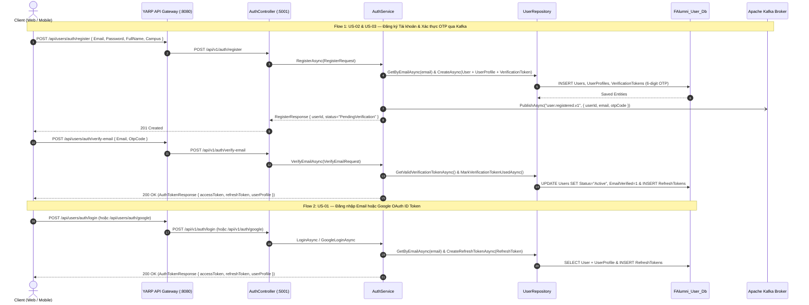
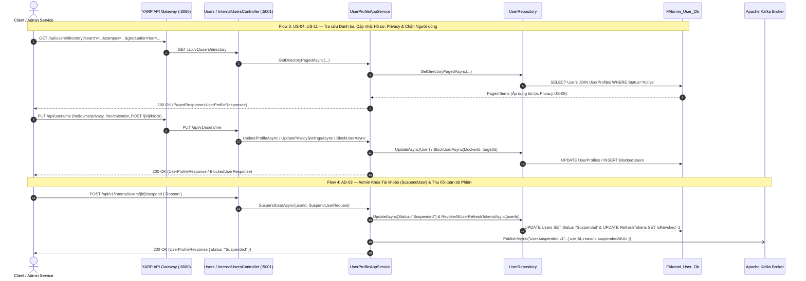

# Sequence Diagram — User Service (`f-alumni-user-service`)

> **Thành viên thực hiện**: Trương Chí Trung (`chstrg2208` — Backend 1)  
> **Service**: `f-alumni-user-service` (.NET 10)  
> **File Draw.io (Trắng Đen Chuẩn UML)**: [`docs/architecture/f-alumni-user-sequence-diagram.drawio`](architecture/f-alumni-user-sequence-diagram.drawio)

---

## 1. Luồng 1 & 2: Đăng ký Tài khoản, Gửi OTP qua Kafka, Xác thực Email & Đăng nhập JWT / Google OAuth (`US-01..US-03`)

---

## 2. Luồng 3 & 4: Tra cứu Danh bạ, Cập nhật Hồ sơ/Privacy, Chặn Người dùng (`US-04..US-11`) & Admin Khóa Tài khoản (`AD-03`)

